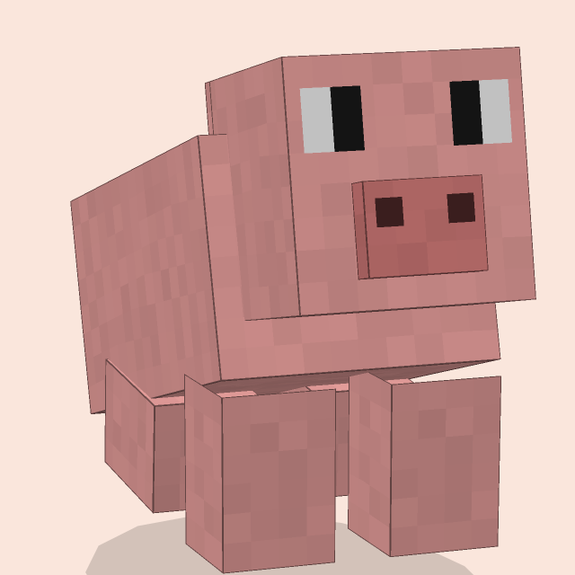
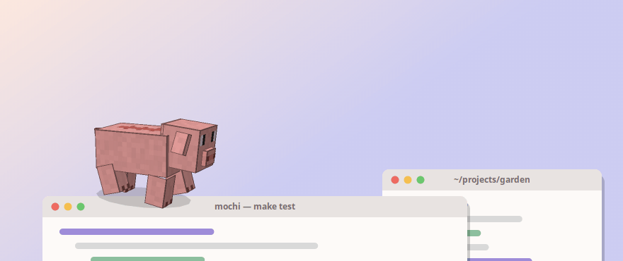
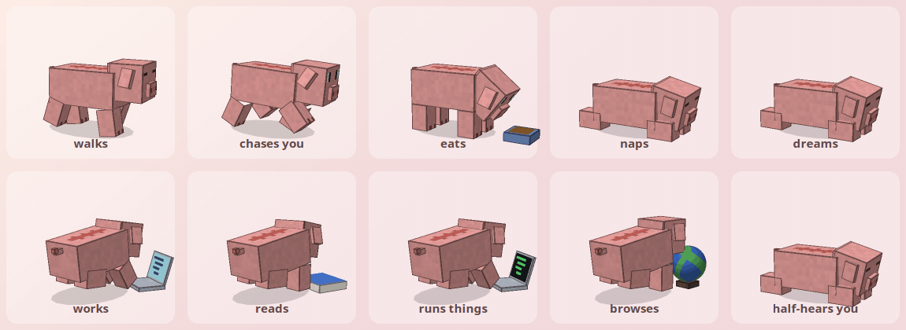
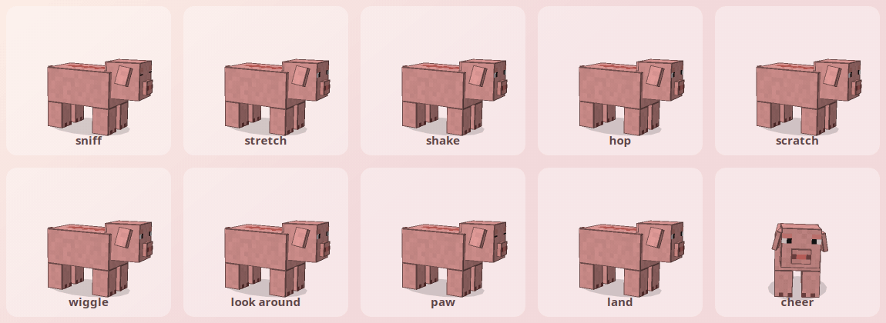
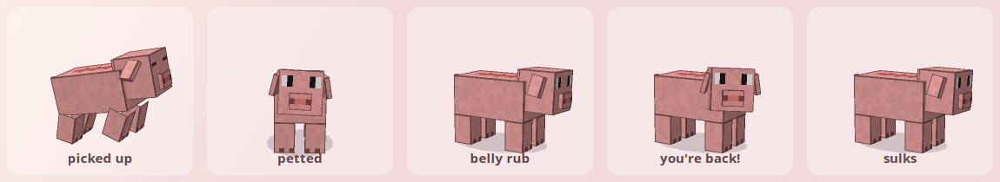
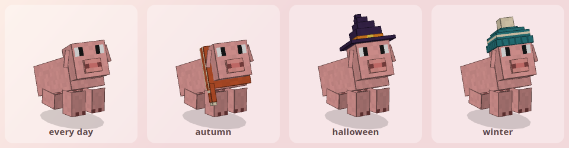
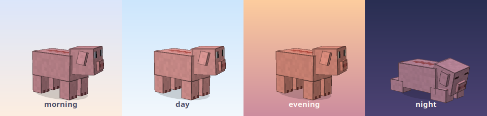
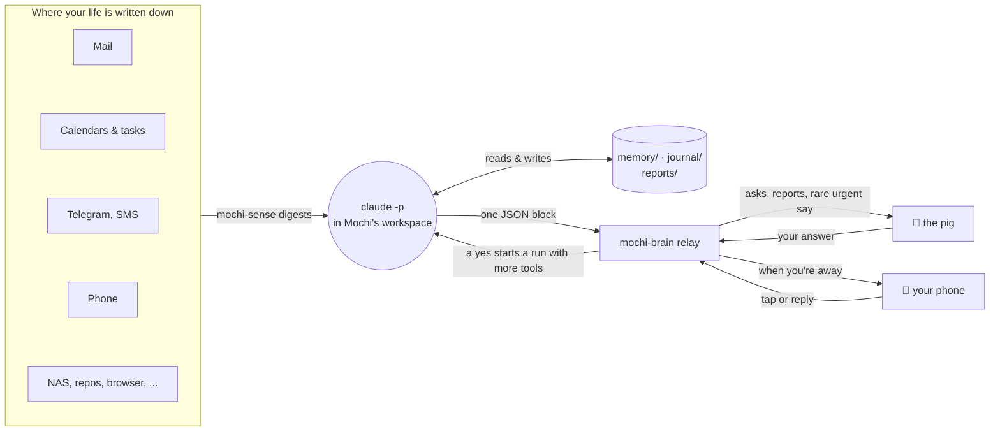

<p align="center">
  
</p>

<h1 align="center">Mochi</h1>

<p align="center">
  <b>A small pixel pig that lives on top of your windows, with Claude Code for a brain.</b><br>
  It walks your title bars, naps, eats, cheers when your build goes green,<br>
  and quietly keeps the threads of your life from slipping.
</p>

<p align="center">
  
  
  
  
  
</p>

<p align="center">
  
</p>

<p align="center">
  <a href="#the-pig">The pig</a> ·
  <a href="#the-mind">The mind</a> ·
  <a href="#quick-start">Quick start</a> ·
  <a href="#use">Use</a> ·
  <a href="#the-brain">How the brain works</a> ·
  <a href="#privacy">Privacy</a>
</p>

---

Mochi is two things that grew up together:

- **`xpet`**, a 3D Minecraft-style pig that lives on your X11 desktop. One C++ file and a few headers, software-rendered
  with Cairo at 30 fps, no GL, no engine. It stands on your windows, rides along when you drag them and falls off when you
  close them.
- **`mochi-brain`**, a thin relay that wakes [Claude Code](https://claude.com/claude-code) in the pig's own workspace
  about every half hour, and whenever something new reaches you. Claude reads its notes, looks around your mail,
  calendar, chats and repos, carries the open loops, and almost never interrupts. It was written for one person's brief:

> *"I have many things going in my life. I have many places those things are registered or described. My main target is
> to have an entity that would be in the know and could act benevolently for me. Keep me going and moving light through
> life."*

The pig is useful on its own (a desk pet, and a live avatar for your Claude Code sessions). The brain is the ambitious
half: it is built around one person's setup, and reading `brain/CLAUDE.md` is the best way to see what it does and why.

## The pig

<p align="center">
  
</p>

**It has a life of its own.** A four-legged gait that matches its ground speed (a trot when it chases your cursor),
each foot lifting as it swings forward, the head held level while the body sways; it steps round on its feet when it
turns on the spot. Breathing, floppy ears that bounce as it goes, a wagging tail nub, blinking at a natural rhythm. It eats when it's hungry, chewing with a working snout as
the bowl empties; it naps and twitches a leg in its sleep. There is nothing to feed and no stats to manage: it looks
after itself, and time passes gently while it isn't running. It doesn't die.

**It works when you work.** Hooked into Claude Code, it turns to face into the screen and sits down at its laptop when
a session writes code, a book when it reads or searches, a terminal when it runs things, a globe when it browses,
tapping the keys and following the lines.

<p align="center">
  
</p>

**It has tricks.** On its own it sniffs the ground, stretches, shakes, scratches, wiggles, hops, paws at the floor
and looks around. It
cheers (two jumps, turned round to you) when a Claude run finishes that touched five or more files, and sulks when a run
keeps failing. Squash before a hop, stretch on take-off, a settle after landing: poses ease into each other instead of
snapping. The ears follow through: flung up in a fall, slapped down on landing, flapping in a shake, flat when it
sulks or sleeps.

<p align="center">
  
</p>

<p align="center">
  
</p>

**It notices you.** Its eyes get to your pointer first and the head follows, looks over at the window you're working in, and looks out at *you*
when it talks, when you pet it, and when you come back after a break. Pet it and it nuzzles your hand (until it has
had enough and shakes its head). Pick it up and it kicks; throw it and it tumbles, then squashes on landing. Now and then
it walks over to sit on the window you've settled into.

<p align="center">
  
</p>

**It dresses for the season,** and makes its own clothes. On *workshop nights* the brain gets an hour in its own git
worktree of this repo to make one thing about the pig better: a costume for a date coming up, a new trick, a better
reaction to your desktop. It renders what it made, looks at the picture, iterates, and must pass the render test. In
the morning you get one quiet line in the menu: **Keep it** or **Undo**. An undo is the most useful thing you can tell
it, and it writes down why.

<p align="center">
  
</p>

**It lives in your light.** Warm in the evening, cool and dim at night. Its skin has a faint per-texel tone, and the
whole thing is Minecraft boxes drawn by a tiny software renderer in `src/art3d.hpp` (the model, the rig, the renderer).
Its face, ears, hooves and much of how it moves are rebuilt after the pig in FreshLX's
[Fresh Animations](https://modrinth.com/resourcepack/fresh-animations) resource pack (and its Extensions); none of the
pack's files are included here.
It hides while a fullscreen app is focused.

## The mind

<p align="center">
  
</p>

**Quiet is the rule.** Most rounds end with nothing to show: what Mochi noticed goes into its journal, not your face.
When something needs you, it becomes an **ask**: a small yellow dot by the pig's head that waits until you choose to
look. Claude designs each question itself, with its own buttons ("which evening?" → *Tue* / *Thu* / *neither*), and
**Chat about it** on every ask opens a terminal with Mochi in it, resumed from the very run that asked. The pig only
speaks up on its own for what can't wait an hour.



**What it does in a day.**

| when | what runs |
|---|---|
| about every 30 min while you're at the desk | a **round**: read the notes, look around, carry the open loops, usually say nothing |
| a chat settles, mail lands, a calendar event moves, a call gets transcribed | a **catch-up**: is it news? update the loops, tell you only if it changes something |
| first round after 09:00 | the **morning brief**, under 25 lines, behind the dot |
| you're away | asks go to your phone as buttons; the bar for asking doesn't move |
| a watch it set fires ("wake me when that reply arrives", "wake me Friday at 10") | an early round, rationed |
| night | a **dream** (fold days into patterns), a **study** session (who you are, from your archives), a **workshop** (the pig) |
| once a week | **the week with Mochi**: what it took off your plate, what it got wrong, what it's carrying |

**Safety lives in the relay, not the prompt.** Each kind of run gets an allow-list of tools: rounds read and draft,
runs you said yes to may act, and a deny list no level overrides (no `sudo`, no deleting mail, no force-push, no
sharing Drive files). Sending mail, a Telegram message or a text as you follows one consent rule, and the risky ones
ask your phone first. Every action is logged.

## Quick start

Needs `libx11-dev libxext-dev libxrandr-dev libcairo2-dev`.

```sh
make && ./xpet          # just the pig
make install            # → ~/.local/bin/xpet, mochi-brain, mochi-sense, ... and Mochi's CLAUDE.md
make install-autostart  # start both at login, restarted by systemd if they crash
make test               # renders every pose, action and costume and checks each frame
make readme-art         # re-renders the pictures in this README (needs ffmpeg)
```

The pig alone needs nothing else. The brain needs the `claude` CLI; each source it reads is optional and set up in
`~/.config/mochi/sources.json` (start from `sources.example.json`). The sections below cover each one.

| | |
|---|---|
| `src/` | the pig: `main.cpp` (its life, the desktop, the menu, the socket), `art3d.hpp` (model, rig, renderer), `wardrobe.hpp` (costumes and their calendar) |
| `brain/` | the relay (`mochi_brain.py`), the senses (`mochi_sense.py`), one tool per service (`mochi_mail.py`, `mochi_calendar.py`, `mochi_tg.py`, ...), and `CLAUDE.md`, Mochi's standing brief |
| `app/` | Mochi on the phone: a plain-Java Android app, no Gradle |
| `relay/` | a blind, end-to-end-sealed mailbox between the phone and the desk |
| `dist/` | systemd units and the autostart entry |
| `tests/` | the render test, the README renderer, unit tests for the tools |

---

## Use

- **Left-click**: pet it (or, right after a wheel preview, open that question)
- **Middle-click**: one line about what it's up to
- **Wheel**: flip through its questions in a bubble without opening the panel
- **Drag**: pick it up; let go mid-swing to throw it. Set it down gently and it stays there for a while.
- **Right-click**: menu (Give me a task..., Open a chat, Shoo for 10 min, Quit; plus "N questions for you" when it has some)

It looks after itself: it eats when hungry, naps when tired, and now and then chases your cursor for fun; there is no feeding or stats to manage. It hides while a fullscreen app is focused.

State lives in `~/.config/xpet/state` and time passes (gently) while it's not running. It doesn't die.

Options: `--name NAME`, `--reset`, `--sheet out.png` (render every pose to an image; `XPET_SHEET_ZOOM=4` for a big one).

## Always on

`make install-autostart` puts `dist/xpet.service` and `dist/mochi-brain.service` in `~/.config/systemd/user/` and
`dist/xpet.desktop` in `~/.config/autostart/`. At login the autostart entry hands the X display to systemd and starts
both services; systemd restarts them if they crash. Menu → Quit stops the pig for real (until next login).
It also installs `dist/mochi-mail.timer` (pull mail every ten minutes for `mochi-sense mail` and the mail watches);
enable it with `systemctl --user enable --now mochi-mail.timer` once isync and notmuch are set up.
`systemctl --user start xpet` brings it back, and deleting the autostart file turns autostart off.

**Google Tasks** has no CalDAV and takes no app passwords, so `mochi-tasks` needs an OAuth client of your own, once:
in the Google Cloud console make a project, enable the Google Tasks API, set up the OAuth consent screen (External,
add yourself as a test user, then **Publish app**: in Testing, Google expires the refresh token after 7 days), and
create an OAuth client ID of type *Desktop app*. Save its JSON as `~/.config/mochi/google-oauth-client.json` and run
`mochi-tasks auth`; Google warns that the app is unverified (it is yours: Advanced → continue).

**Google Drive, Docs, Sheets, Calendar and Contacts** go through `mochi-drive`, `mochi-calendar` and
`mochi-contacts`, which share one sign-in per Google account (`mochi-google`, on the same OAuth client): enable the
Google Drive, Docs, Sheets, Calendar and People APIs in that project, then `mochi-google auth ACCOUNT` once per account
and tick every box (accounts are named as in `mail.accounts` in sources.json). App passwords don't work here either.

`dist/mochi-archive.timer` runs `mochi-archive sync` every hour: your interactive Claude Code sessions and your
conversations with Mochi (chats, requests, its questions and your answers, from its transcripts plus the relay's
`comms.jsonl`) go into the self-hosted LLM chat archive on sff as two providers, `claudecode` and `mochi`, over ssh
with Mochi's key. Its rounds, dreams and `claude -p` runs stay out. `mochi-archive sync --dry-run` counts what would go.

## The brain

Claude Code is the brain. `brain/mochi_brain.py` (installed as `mochi-brain`) is a thin relay with no judgement in
it. It needs the `claude` CLI, plus `xprop`, `zenity` and `notify-send`; "Show me" renders markdown with `gir1.2-webkit2-4.1` and `python3-markdown` (plain zenity text without them).

About every 30 minutes while you're at the computer (and when you ask, when you answer an offer, when you come
back from a break of two hours or more, and once first thing each day) the relay starts `claude -p` in Mochi's
workspace, `~/.local/share/mochi/`:

- `CLAUDE.md` is Mochi's standing brief (installed from `brain/CLAUDE.md`): who it is, why it exists, what it may
  look at, how a round goes, and the quiet rule.
- `memory/` is what it knows, written by itself: `life.md` (the map of your life and where things are tracked),
  `open-loops.md` (everything in flight), `preferences.md` (how you want it to behave, your "never"s),
  `last-round.md` (handoff to its next self).
- `journal/` has one file per day of what it noticed and did; `mochi-brain --seen` prints the last two.
- `reports/` holds the morning brief and longer write-ups.

Each round, Mochi reads its notes and the relay's context (idle time, the current window and the last hour of apps,
your Claude Code sessions, your answers and asks since last time, its pending offers), looks around proportionately
(mail, Drive, calendar if connected, repos, machine health), does what it is allowed to do by itself (drafts,
summaries, its own notes), and ends with a small JSON block. That block is the only way a run reaches you:

- **asks**: anything that would change the world outside its workspace, or any question it wants to put to you.
  Claude designs the small UI itself: the text and up to five menu options in its own words (a plain yes/no offer, a
  "which evening?" with choices, a check-in with a graceful exit). They wait silently behind a small yellow dot next
  to the pig's head; right-click → **N questions for you** opens a panel beside the pig with the question on top and
  the options below. With several waiting, "Next question" / "Previous question" (or the mouse wheel over the
  panel) flip between them, answering one moves on to the next, and "Later" keeps one waiting. "Not now", "Never", "Dismiss" just
  close it (Mochi hears about it next round); "Show me" opens a report; any other option, "Yes, do it" included,
  starts a second run with a broader tool set and the notes Mochi wrote for itself about that answer.
- **Chat about it** is on every ask: it opens a terminal with Mochi in it, resumed from the very run that raised
  the question, so it remembers why. There you talk normally; chats run in bypass-permissions mode, with the relay's never-list still denied. **Open a chat** in
  the pig's menu (or `mochi-brain --chat`) opens a fresh chat any time.
- **Recent...** in the menu lists the last dozen asks that were answered, dismissed or expired (on the pig or the
  phone). Picking one puts it back behind the dot as it was and opens it, so "Chat about it" resumes that run's
  session, or you can give a different answer this time. Mochi hears that you reopened it.
- **report**: a file worth reading (the morning brief), also behind the dot.
- **say** with **urgent**: the pig speaks and hops. Reserved for what cannot wait an hour. If you ignore an urgent
  question (or a Claude session stuck on a permission) for half a minute, it walks right up to the screen, big head at
  the glass, stares at you for a few seconds, then walks back, and tries again a couple of minutes later. A non-urgent `say` is
  dropped by the relay, so quiet is enforced, not just requested.

The relay decides *when*, never *what*. It also enforces *which tools* a run may use, because safety should not live
in a prompt: a round gets read-only tools, mail drafts and sends through `mochi-mail` (msmtp; the brief says when it may send on
its own and when it must ask first, and every send is logged), your Google Tasks through `mochi-tasks` (read freely,
changed under the same consent rule, every change logged, no delete), your Google Drive, Docs and Sheets and your calendars in every signed-in account through `mochi-drive` and `mochi-calendar`
(read in rounds; created or edited only in runs you asked for or approved, every change logged, nothing deleted or
shared), your contacts through `mochi-contacts` (read-only), the SMS on your phone through `mochi-sms` (Google Messages for Web in Mochi's Chrome, and KDE Connect
over the LAN: read freely, a text sent only under the mail rule, every send logged), and writes inside `memory/`, `journal/` and `reports/`;
a run you asked for or approved may also edit files and run commands; and a deny list no level can override (no
`sudo`, no deleting mail or sending through the Gmail connector, no force-push, no `rm -rf`, no sharing Drive files). Rounds use Sonnet; things
you ask for use the default model. Constants at the top of the script: cadence, daily cap, models.

You can also just ask it: menu → **Give me a task...**, or

```sh
xpet --ask 'find the biggest files in ~/Downloads'    # same thing from a shell
mochi-brain --round       # do a round now
mochi-brain --trigger 'the backup finished'   # wake Mochi for an event (a round, once the cooldown allows)
mochi-brain --watches     # Mochi's own alarms and where each stands
mochi-brain --chat        # open a chat with Mochi in a terminal
mochi-brain --status      # the pig says what it's up to
mochi-brain --seen        # Mochi's journal for the last two days
mochi-brain --report      # open the latest report
mochi-brain --log         # the relay's recent log
mochi-brain --denials     # tools Mochi's runs reached for and were refused (the allow-list audit, kept by the relay)
mochi-brain --week        # the relay's numbers for last week (what the week note is built on)
```

**Results are one line.** When you ask Mochi for something, or say yes to an offer, the answer is one line in the
pig's bubble (and a message on your phone if you're away or asked from there); the full write-up is filed under
`reports/` and listed in the menu's **Recent...**, where "Show me" and "Chat about it" still work. There is no
"done" question to dismiss any more: a finished task raises an ask only when a real next step needs you.

**Nights.** While you're away between 02:00 and 10:00 nothing starts on the clock: no light rounds, no catch-ups (new
messages wait for the morning round), no plain triggers. Mochi's own watches still wake it, as do urgent triggers and
the night's own runs (dream, workshop, study). The morning brief is written in the first round at or after 09:00.
Presence comes from real input (XInput2 raw key, button and pointer events), not from X's screensaver counter, which
any player or game resets with XResetScreenSaver: that kept the relay believing you were at the desk all night on
2026-10-12/13 and cost 15 empty rounds. When the two disagree the relay logs it once an hour, so the culprit can be found.

**The week note.** In the first dream after a week ends, Mochi writes `reports/week-YYYY-Www.md`, a short letter: what
it took off your plate, what it got wrong, what it is carrying for you, what it would need to do more, and the relay's
numbers for the week. It waits behind the dot like a brief. It is the one report a dream may raise.

Everything the relay does is appended to `~/.local/share/mochi/actions.log`; everything Mochi thought is in its
journal and in the Claude Code transcripts for that directory.

### Waking up early: triggers and watches

The clock is not the only thing that starts a round. The relay also listens for **triggers**, each a reason string
that becomes the round's reason: `mochi-brain --trigger [--urgent] TEXT` from you, a script or a hook; the relay's
own watchers (a disk past 92%, a battery under 15% and discharging, a systemd unit that newly failed, a Claude Code
session stuck on a permission prompt for twenty minutes); and **Mochi's own watches**. A triggered round is rationed:
no sooner than ten minutes after the previous round began, at most eight a day, none while you're away at night.
Urgent triggers skip all three. The quiet rule is unchanged: an early round still ends silent unless something is
worth an ask.

Watches are Mochi's alarms, written by Mochi itself in a round to `memory/watches.json`: "wake me when a mail from
We-ID arrives", "wake me on the 16th at 10:00", "wake me when this path changes", "wake me when `ping sff.local`
succeeds again" (`cmd` watches are limited to the same read-only commands a round may run). Each has a `why` for the
round that gets woken, an optional `until` (expiring unfired also wakes Mochi once: "no reply by Friday" is news), and
the relay keeps the baselines and fired marks so a watch fires on what changes after it was written, not on what was
already true. `mochi-brain --watches` lists them; the details are in `brain/CLAUDE.md` under "Waking up early".
Constants in `brain/mochi_brain.py`: `TRIGGER_COOLDOWN`, `TRIGGERED_PER_DAY`, `DISK_FULL_AT`, `BATTERY_LOW_AT`,
`STUCK_AFTER`.

### Senses and the dossier

`brain/mochi_sense.py` (installed as `mochi-sense`) is how Mochi sees past this machine. Each subcommand reads
one source and prints a short digest: `browser` (Firefox/Chromium history: sites, searches, titles), `shell`,
`telegram` (your self-hosted tg-archive), `llm` (your LLM chat archive, live or its local sqlite copy), `nas`
(Synology home share over SMB), `photos` (Immich), `network` (hosts up/down, web services, Tailscale, KDE
Connect, mDNS), `home` (Home Assistant), `hosts` (ssh reports with Mochi's own key), `mail` (the local Maildir), `sessions` (Claude Code transcripts by project), `repos`, and `sources` (what is reachable).
Everything is read-only: sqlite files are copied before being opened, the NAS is only listed, web services
only GET. `~/.config/mochi/sources.json` says where things are and holds any passwords (never printed; start from
`sources.example.json`); where
none is set, a service is read with your own Firefox session cookie.

The relay runs `mochi-sense all` before every round and leaves `senses/digest.md` in the workspace; rounds may
also call any sense directly. Mochi keeps what it learns in `memory/dossier.md` (dated and sourced) and the
registry of sources in `memory/sources.md`; the "Knowing them" section of `brain/CLAUDE.md` sets the method
and the privacy rules (summarize, never quote private messages, never copy secrets, go no deeper than acting
for you requires).

```sh
mochi-sense --help                      # all senses
mochi-sense telegram search "center parcs"
mochi-sense browser --days 7 --grep onshape
mochi-sense nas ls Documents
mochi-brain --senses                    # the digest the last round saw
mochi-brain --discover                  # a long run that only works on the dossier
mochi-brain --dream                     # sleep on it: fold journals into memory/patterns.md (nightly when away)
mochi-brain --study                     # a night study session: read the archives for who you are (memory/portrait.md)
mochi-brain --portrait                  # what Mochi has understood about you so far
```

### Your phone (Telegram)

Mochi only runs rounds while you're at the computer, so the one thing that matters most, something that can't wait until
you're back, had no way to reach you. `brain/mochi_telegram.py` (installed as `mochi-telegram`) is a Telegram bot that
talks to you and only you:

- **While you're away** every ask Mochi raises also arrives on your phone as a message with its options as buttons
  (plus "Later"). Tap one and the relay acts on it exactly as if you'd clicked the pig; reply to the message in your
  own words and that becomes the answer. Asks already waiting follow you to the phone, silently, when you leave.
- **Reports** arrive as their title with a "Show me" button; the body is only sent when you tap it.
- **An urgent `say`** (the thing the pig would hop for) is sent as a message that may buzz. Buzzing is rationed:
  `TG_AUDIBLE_PER_DAY` (3) per day, none in `TG_QUIET_HOURS` (23:00-08:00) except an urgent say. Everything else is
  delivered silently.
- **Write to it** and the text is a task for Mochi, answered in the chat when it's done. `/asks` re-sends what's
  waiting, `/brief` the latest report, `/seen` today's journal, `/status`, `/round`.
- **Away rounds.** With the bot connected, the relay runs a light round every `AWAY_ROUND_EVERY` (2 h) while you're
  away, outside quiet hours, so there is something to tell you. The brief in `brain/CLAUDE.md` tells Mochi to keep
  what crosses the wire short and vague: names of things, never contents.

Setup: create a bot with @BotFather, put its token in `~/.config/mochi/telegram.token` (mode 600), open the bot in
Telegram and press Start, then `mochi-telegram pair --write` (it waits for your message and saves your user id as
`telegram.owner_id` in `sources.json`). Messages from any other account are ignored. `mochi-telegram status` checks
the whole chain; `mochi-telegram send hi` is a test. Restart the relay after changing the config. The bot's name, bio
and command menu are set through the API; `make avatar` renders its profile picture (`dist/mochi-avatar.png`) with the
pig's own renderer.

**Files, both ways.** Send the bot a photo or a document (with a caption saying what to do with it, or none) and it
lands in `~/.local/share/mochi/inbox/` and becomes a task for Mochi, which reads pictures and PDFs itself. Sent as a
reply to one of Mochi's questions, it arrives as that answer. The other way, a run that you asked for can attach
`files` to its answer and they reach your phone at once; a round cannot push files, its files wait behind the dot and
"Show me" delivers them, on screen or to the phone. A report can be a PDF or a picture too. From a shell or a chat:
`mochi-telegram file PATH... [--caption TEXT] [--photo]`. Limits are Telegram's: 50 MB out, 20 MB in.

### Telegram as you (mochi-tg)

The bot is Mochi's own voice. `brain/mochi_tg.py` (installed as `mochi-tg`) is yours: it sends a Telegram message
from *your* account, in your name, after you allow that one message on your phone (the bot shows the recipient and the
text with **Send it** / **Deny**; no tap, no message). It exists because for a week Mochi could only hand you lines to
paste ("ask her where the contract is"). Setup once: your API id and hash in `~/.config/mochi/telegram-api.json`
(the Telegram archive's own pair was copied there), Telethon in the tools venv (`make tools`), then `mochi-tg auth`:
your phone number, the code Telegram sends you, your two-step password if you have one. The session lives in
`~/.config/mochi/telegram-user.session`.

`mochi-tg status`, `mochi-tg dialogs [QUERY]` (your chats with the archive's ids), `mochi-tg send WHO "TEXT" [--why
TEXT] [--reply-to ID] [--dry-run]`, `mochi-tg log`. The relay allows `send` only in runs you asked for or approved,
rations the questions (15 a day), and the brief's rule is the mail rule: only what you asked for, in your voice, never
money or commitments, never to a channel or a bot. `auth` and `logout` are on the never-list. The same trade as the
vault's "remember": the session file is readable by anything running as you, so the tap guards against mistakes, not
against a run set on getting around it.

### Your phone (the app)

`app/` is Mochi on the phone: a plain-Java Android app (no Gradle, no third-party code; `app/build.sh` builds it from
the SDK alone, `app/install.sh` installs and pairs it over adb and grants it everything). It runs as a foreground
service and reports location, battery, network, screen, steps, every notification (messages with sender and text,
mail, deliveries, alerts), what's playing, where the sound goes, calls, texts and app usage; the desk can send it
`locate`, a `buzz`, an ask with buttons, and (only in a run they asked for) take a picture with either camera or
record a clip from the microphone, which comes back transcribed (faster-whisper in Mochi's tools venv). Everything travels through `relay/` (a blind mailbox on mc.tsatsin.com,
`relay/deploy.sh`) sealed end to end with X25519 + HKDF + AES-256-GCM, a fresh ephemeral key per message; the relay
holds only ciphertext and keeps nothing after delivery. If the relay is out of reach for half an hour the phone mails
the same sealed blobs through Gmail to an address mbsync already pulls. On the desk `mochi-phone serve` (a user
service) opens them into `~/.local/share/mochi/phone/`; `mochi-sense phone` is the digest's view, `mochi-phone
where|now|notifs|calls|sms|usage` the detail, and the relay's live feed starts catch-ups for missed calls, texts and
messages from people. The rules for using it are in `brain/CLAUDE.md`, "Their phone".

### This machine's eyes and ears

`mochi-desk photo | audio --seconds N | screen [--monitor N]` are the desk's twin of the phone's captures: a still
from the webcam, a clip from the microphone (transcribed), what's on a monitor. Same rule as the phone: only in a
run they asked for. `mochi-desk media` lists what was taken; files live in `~/.local/share/mochi/desk/media/`.

### Its own browser

`brain/mochi_browser.py` (installed as `mochi-browser`) gives Mochi a Chrome of its own: a separate profile in
`~/.local/share/mochi/chrome` with its own cookies, logins and history, driven through Google's
[chrome-devtools-mcp](https://github.com/ChromeDevTools/chrome-devtools-mcp) (`npm install -g chrome-devtools-mcp`;
the relay finds it on PATH or in an fnm/nvm install). The relay writes the MCP server config before every run and
passes it with `--mcp-config`, so the `mcp__chrome__*` tools (navigate, snapshot, screenshot, click, fill, ...) are
there in every round, task and chat:

- the Chrome is an ordinary headed one on a nested X display (Xephyr) whose window the relay keeps hidden, off the
  screen and off the panel (wmctrl): a headless Chrome can't be shown later and sites treat it with suspicion, this
  one is a real browser that just isn't on your desk. Runs and chats both use it; it's closed after a run unless it's
  on your screen or a chat still has it. Without Xephyr/wmctrl, runs fall back to a headless Chrome;
- `mochi-browser show` brings that window to the front and `hide` takes it back. Mochi does this when a page needs
  you (a captcha, a code, a login it may not do itself); `mochi-browser open [URL]` is the same for you, e.g. to log
  Mochi into something (Mochi never types your passwords), with a localhost-only debugging port;
- a round may look and click; typing into forms, uploads and `evaluate_script` are only in runs you approved or chats;
- screenshots can only be written under `reports/` in its workspace. `mochi-browser status` shows the whole chain.

### Your downloads (mochi-torrent)

`brain/mochi_torrent.py` (installed as `mochi-torrent`) lets Mochi search rutracker.org with your account and add
downloads on your Deluge. rutracker sits behind Cloudflare and shows its search to members only, so the tool doesn't
fetch pages itself: it opens a tab in Mochi's Chrome (started hidden if it isn't up), reads the page there, and closes
the tab; log Mochi's Chrome into rutracker once (`mochi-browser open https://rutracker.org/forum/login.php`, or let
Mochi do it with `mochi-vault fill` in a run you asked for) and the profile keeps the session. `search WORDS [--sort
seeds|date|size]`, `show TOPIC` (size, seeds, magnet, the description's start) and `status [--all]` (what Deluge is
doing, where downloads land, labels) are allowed in every run; `add TOPIC|MAGNET [--to DIR] [--label L] [--paused]
--why TEXT` downloads the .torrent inside that tab (it carries your passkey) and hands it to Deluge's web JSON-RPC
base64, only in runs you asked for or approved. Nothing removes a torrent; every add is in `mochi-torrent log`.

Deluge's side: `"torrent": {"deluge": {"url": "https://host/deluge/"}}` in `sources.json`, then `mochi-torrent
setup` once: it asks on your phone (through mochi-vault, like a sign-in) to copy your Bitwarden login for that host
into `~/.config/mochi/deluge.env` (mode 600; `mochi-vault export`, a command the relay never allows Mochi), then tries
Deluge's own web password (that one, or the default) and stores what worked. The brief's rule is the mail rule: Mochi
adds on its own only what you asked for in so many words; a wish it noticed becomes an ask.

**Lossless to MP3 320** (`brain/mochi_music.py`, installed as `mochi-music`). Your seedbox mirrors finished downloads
into `Downloads/` on the NAS, whose home share is mounted at `~/share` (`music.nas_root` in `sources.json`).
`mochi-torrent add ... --convert` or `mochi-music queue TORRENT` puts a lossless download on a list;
`dist/mochi-music.timer` runs `mochi-music sync` every 15 minutes, which converts each entry once Deluge reports it
finished and the folder on the NAS is complete: FLAC/APE/ALAC/WavPack/WAV to MP3 320 CBR with tags (ffmpeg, three at a
time), a single image with a .cue split into tracks, covers copied, into `Music/<folder name minus the format tags>`.
The source stays where it is (seeding), nothing is deleted, every album is a line in `mochi-music log`, and a
finished batch pokes the relay (`mochi-brain --trigger`) so Mochi can tell you. `mochi-music convert DIR` does one
folder by hand.

## Talking to it

The pig listens on a user-only Unix datagram socket (`$XDG_RUNTIME_DIR/xpet.sock`), one flat JSON object per message:

```sh
xpet --send 'build finished'                        # plain text = speech bubble
xpet --send '{"event":"say","text":"hi","secs":5}'
xpet --send '{"event":"emote","emote":"happy"}'     # happy | oof | sleep
xpet --send '{"session":"x","event":"tool_start","tool":"Bash","detail":"deploying"}'
```

Activity events (`prompt`, `tool_start`, `tool_end`, `notify`, `stop`, `session_end`, ...) make it drop what it's doing
and act them out; it goes back to normal life when a session stops or goes quiet for 10 minutes.

### As Claude's avatar

`xpet --send-hook` reads a Claude Code hook's JSON from stdin and forwards a summary (file name, a command's
description, a host name, the session's working directory; never prompts, file contents or full commands) to the
pig and to the brain. It prints nothing and returns in a few ms even if neither is running. Point every hook
event at it in `~/.claude/settings.json`:

```json
"PreToolUse": [{ "matcher": "*", "hooks": [{ "type": "command", "command": "~/.local/bin/xpet --send-hook", "timeout": 2 }] }]
```

(same for SessionStart, UserPromptSubmit, PostToolUse, PostToolUseFailure, Notification, Stop, SubagentStop,
SessionEnd, PreCompact). Run the pig with `--no-details` to keep file names and commands out of its bubbles.

## Privacy

Mochi is built to read a lot about you: browser history, chat and mail archives, your NAS, your shell history and
Claude Code transcripts, and it can send mail as you. Everything stays on your machine: its notes live in
`~/.local/share/mochi/`, its config in `~/.config/mochi/`, and neither is part of this repository. Rounds run through
Claude Code, so what a round reads is sent to Anthropic's API like any other Claude Code session. With the Telegram bot
set up, Mochi's asks and whatever you tap or type in reply pass through Telegram's servers; the brief tells Mochi to
keep those messages to names of things and send report bodies only when you ask. The relay enforces
tool allow and deny lists per run; `brain/CLAUDE.md` sets the rules for what it writes down and when it may send.
